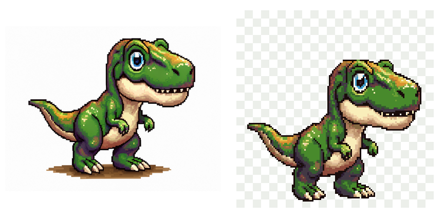

# pxl-cleanup

Turn AI-generated "pixel art" into real pixel art sprites.

Image models like FLUX produce images that *look* like pixel art from a distance, but the "pixels" are uneven blocks with gradients inside them, sitting on a background, with tens of thousands of colors. `pxl-cleanup` turns that into a small, grid-aligned, transparent sprite with a limited palette, ready to animate or drop into a game.



## Install

Requires Python 3.10+.

```bash
git clone https://github.com/alvincrespo/pxl-cleanup.git
cd pxl-cleanup
python3 -m venv .venv && source .venv/bin/activate
pip install -e .
```

## Usage

```bash
# one sprite: writes out/trex/1_nobg.png ... 4_final.png
pxl-cleanup trex.jpg

# a whole roster at once, each in its own subfolder of sprites/
pxl-cleanup beasts/*.jpg --out sprites

# Sega Genesis-style palette (15 colors + transparency)
pxl-cleanup trex.jpg --colors 15
```

Every stage is saved as its own PNG, so when a result looks wrong you can see which stage caused it.

| Option | Default | When to change it |
|---|---|---|
| `-s`, `--pixel-size` | `6` | Width of one fake pixel in the source. Raise it if the sprite is too big for the canvas; lower it if detail is lost. `0` auto-detects. |
| `-c`, `--colors` | `24` | Use `15` for a stricter 16-bit look. Raise it if an accent color disappears. |
| `--canvas` | `128` | Square canvas size. Keep it the same across a roster. |
| `--margin` | `4` | Empty pixels below the feet, for a shadow or platform. |
| `--ground-band` | `0.80` | Brown pixels below this fraction of the image height are removed as ground. `1.0` disables it. |
| `-o`, `--out` | `out` | Output folder. Each input gets a subfolder named after the file. |

## How it works

| Stage | Output | What happens |
|---|---|---|
| 1. Remove background | `1_nobg.png` | A flood fill from the image edges removes near-white background and a brown ground patch. The sprite's dark outline stops the fill, so light areas inside it (teeth, eyes, a pale belly) are kept. The result is cropped to the sprite. No AI model is needed for outlined sprites on a plain background. |
| 2. Recover the grid | `2_grid.png` | [unfake](https://pypi.org/project/unfake/) measures the fake pixel blocks and rebuilds each one as a single real pixel. The T-Rex goes from 680×558 to 113×92. |
| 3. Reduce the palette | `3_palette.png` | k-means clustering over the distinct colors (not pixel counts), so small accents like a stripe or an eye keep their own color instead of being averaged into large areas. |
| 4. Place on canvas | `4_final.png` | The sprite is bottom-centered on a square transparent canvas, with its feet a fixed distance from the bottom. Any two sprites line up without per-sprite positioning. |

The pipeline is also usable as a library:

```python
from PIL import Image
from pxl_cleanup import remove_background, recover_grid, reduce_palette, place_on_canvas

sprite = place_on_canvas(reduce_palette(recover_grid(remove_background(Image.open("trex.jpg")))))
sprite.save("trex.png")
```

## Getting good input

The background stage assumes an outlined character on a plain light background. Add this to your image prompt so every generation fits:

> plain white background, no ground, no shadow, thick dark outline, full body, side view

## Example

[`examples/trex/`](examples/trex/) has the source image and the output of every stage, including a 15-color version.

## Development

```bash
pip install -e ".[dev]"
pytest
```

## License

MIT
